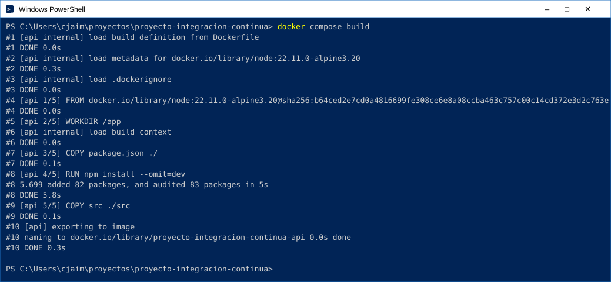
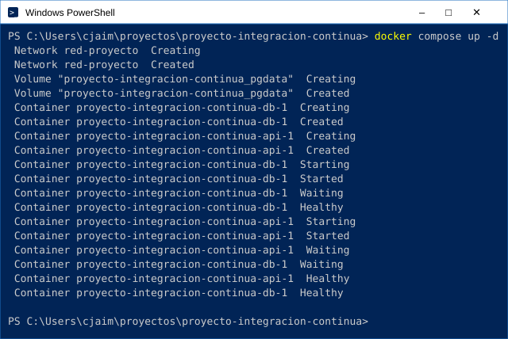
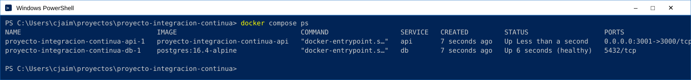
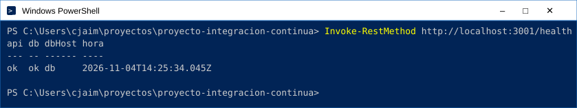
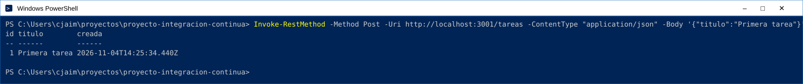
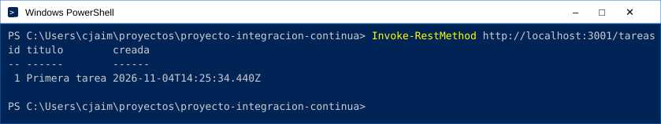
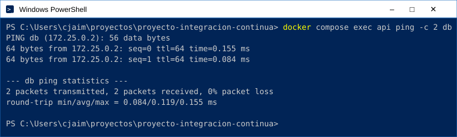
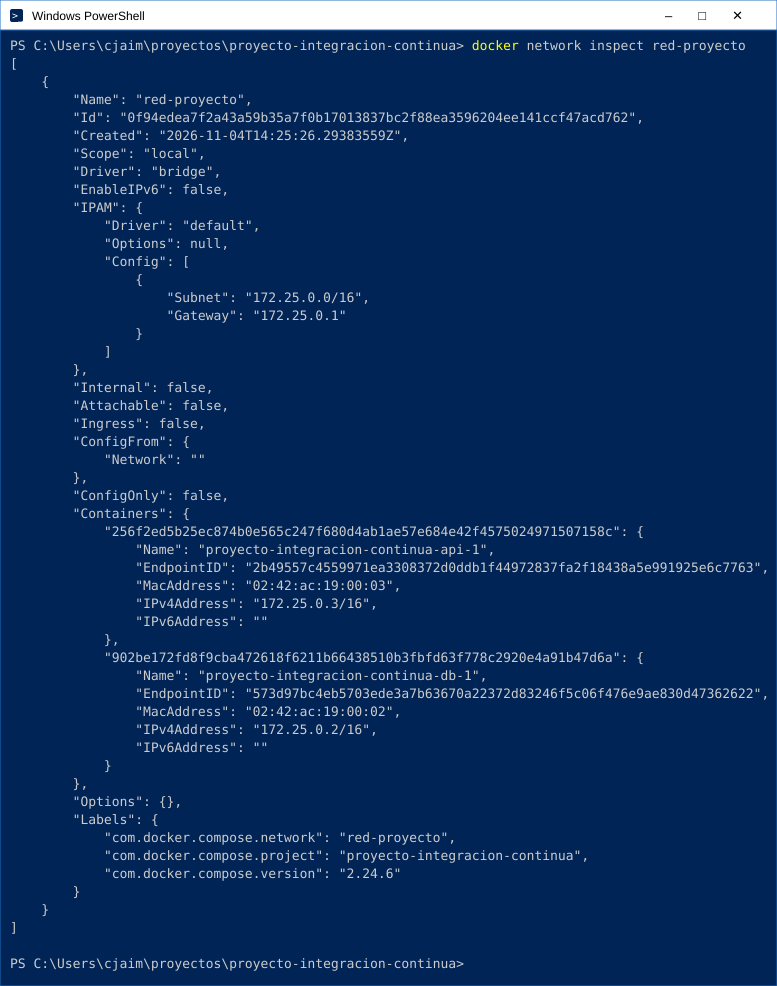

# Proyecto de integración continua: API de tareas con Docker

Proyecto del módulo Énfasis Profesional I (Integración Continua), Politécnico Grancolombiano.

Dos contenedores comunicados entre sí con Docker Compose:

| Servicio | Papel | Imagen | Puerto |
|---|---|---|---|
| `api` | Aplicación (Node.js + Express) | `node:22.11.0-alpine3.20` (Dockerfile propio) | 3000 |
| `db` | Base de datos (PostgreSQL) con volumen `pgdata` | `postgres:16.4-alpine` | 5432 (solo interno) |

La API se conecta a la base de datos usando el **nombre del servicio** `db` dentro de la red `red-proyecto` (variable `DB_HOST=db`), no `localhost` ni una IP fija.

```
Usuario ──► api:3000 ──(red-proyecto)──► db:5432 ──► volumen pgdata
```

## Endpoints

| Método | Ruta | Qué hace |
|---|---|---|
| GET | `/health` | Consulta la hora a la base de datos: confirma que la API llega a `db` |
| POST | `/tareas` | Guarda una tarea (`{"titulo": "..."}`) en PostgreSQL |
| GET | `/tareas` | Lee las tareas guardadas |

## Requisitos

- [Docker Desktop](https://www.docker.com/products/docker-desktop/) instalado y **abierto** (incluye Docker Compose v2)
- Git

## Cómo levantar los contenedores

```bash
# 1. Clonar el repositorio
git clone https://github.com/LEZG1988/proyecto-integracion-continua.git
cd proyecto-integracion-continua

# 2. Crear el archivo de variables a partir de la plantilla (el .env no se sube al repositorio)
cp .env.example .env          # Linux, macOS, Git Bash o PowerShell
# copy .env.example .env      # Símbolo del sistema (cmd) de Windows

# 3. Construir las imágenes y levantar los contenedores
docker compose up -d --build

# 4. Ver que los dos estén corriendo (db debe decir "healthy")
docker compose ps
```

## Paso a paso con la respuesta esperada

Las imágenes muestran la salida real de cada comando ejecutado en Windows PowerShell. Se tomaron con `API_PORT=3001` porque el 3000 estaba ocupado en ese equipo; con la configuración por defecto se usa `localhost:3000`. En Linux, macOS o Git Bash se pueden usar los comandos `curl` del [resumen](#resumen-de-comandos-de-prueba-ida-y-vuelta).

### 1. Construir la imagen de la API

```bash
docker compose build
```

Docker sigue los pasos del [`api/Dockerfile`](api/Dockerfile): descarga la imagen oficial `node:22.11.0-alpine3.20`, copia el `package.json`, instala las dependencias y copia el código. Debe terminar con `naming to ... proyecto-integracion-continua-api done` y sin errores. En la imagen se muestran solo los pasos del Dockerfile.



### 2. Levantar los contenedores

```bash
docker compose up -d
```

Compose crea la red `red-proyecto` y el volumen `pgdata`, arranca primero `db` y espera a que esté **Healthy** antes de arrancar `api` (eso es el `depends_on` con `condition: service_healthy`).



### 3. Ver que estén corriendo

```bash
docker compose ps        # o docker ps
```

Deben aparecer los dos contenedores en estado `Up`. La API publica su puerto hacia el equipo (`->3000/tcp`); la base de datos **no** publica puerto: solo es accesible dentro de la red de Docker.



### 4. Estado de la API y la base de datos

```powershell
Invoke-RestMethod http://localhost:3000/health
```

La API hace una consulta a PostgreSQL y devuelve la hora de la base de datos. `db = ok` indica que la conexión funciona y `dbHost = db` que se conecta por el **nombre del servicio**.



### 5. Ida: guardar un dato

```powershell
Invoke-RestMethod -Method Post -Uri http://localhost:3000/tareas -ContentType "application/json" -Body '{"titulo":"Primera tarea"}'
```

La API inserta la tarea en PostgreSQL y devuelve el registro creado, con el `id` y la fecha que asignó la base de datos.



### 6. Vuelta: leer el dato

```powershell
Invoke-RestMethod http://localhost:3000/tareas
```

La API consulta la tabla y devuelve la tarea guardada en el paso anterior: el dato hizo el viaje completo **api → db → api**.



### 7. La API encuentra a la base de datos por nombre

```bash
docker compose exec api ping -c 2 db
```

Desde dentro del contenedor `api`, el nombre `db` se resuelve a la IP del contenedor de la base de datos gracias al DNS interno de Docker. 0 % de pérdida significa que hay conexión.



### 8. La red propia con los dos contenedores

```bash
docker network inspect red-proyecto
```

La red `red-proyecto` (driver `bridge`) tiene conectados los dos contenedores, cada uno con su IP interna (sección `Containers`).



## Resumen de comandos de prueba (ida y vuelta)

### Linux, macOS o Git Bash

```bash
# Estado: la API consulta a la base de datos
curl http://localhost:3000/health

# Ida: guardar un dato
curl -X POST http://localhost:3000/tareas -H "Content-Type: application/json" -d '{"titulo":"Primera tarea"}'

# Vuelta: leerlo de la base de datos
curl http://localhost:3000/tareas
```

### Windows PowerShell

```powershell
# Estado: la API consulta a la base de datos
Invoke-RestMethod http://localhost:3000/health

# Ida: guardar un dato
Invoke-RestMethod -Method Post -Uri http://localhost:3000/tareas -ContentType "application/json" -Body '{"titulo":"Primera tarea"}'

# Vuelta: leerlo de la base de datos
Invoke-RestMethod http://localhost:3000/tareas
```

### Resultado esperado

```
/health   → {"api":"ok","db":"ok","dbHost":"db","hora":"..."}
POST      → {"id":1,"titulo":"Primera tarea","creada":"..."}
GET       → [{"id":1,"titulo":"Primera tarea","creada":"..."}]
```

`"dbHost":"db"` muestra que la conexión usa el nombre del servicio.

### Comunicación dentro de la red de Docker

```bash
# Desde el contenedor de la API, "db" se resuelve por nombre
docker compose exec api ping -c 2 db

# Los dos contenedores conectados a la red propia
docker network inspect red-proyecto
```

## Apagar

```bash
docker compose down        # apaga y conserva los datos del volumen
docker compose down -v     # apaga y borra el volumen de datos
```

## Solución de problemas

| Problema | Solución |
|---|---|
| `error during connect` o `docker daemon is not running` | Abrir Docker Desktop y esperar a que diga que está corriendo |
| `port is already allocated` en el 3000 | Cambiar `API_PORT` en el `.env` (por ejemplo `API_PORT=3001`) y usar ese puerto en las pruebas |
| `relation "tareas" does not exist` | El script `db/init.sql` solo corre cuando el volumen es nuevo: `docker compose down -v` y volver a levantar |

## Integración continua

El workflow [`.github/workflows/docker.yml`](.github/workflows/docker.yml) se ejecuta en cada push y pull request: construye las imágenes, levanta los contenedores, prueba el guardado y la lectura de una tarea, y los apaga.

## Estructura

```
api/                 Contenedor 1: la aplicación
  src/index.js       Endpoints /health y /tareas
  Dockerfile
  .dockerignore
db/init.sql          Contenedor 2: crea la tabla tareas
docker-compose.yml   Orquestación: red, volumen, variables, depends_on
.env.example         Plantilla de variables (el .env real no se sube)
.github/workflows/   GitHub Actions: construye y prueba en cada push y PR
docs/img/            Salida de cada comando, usada en este README
```
